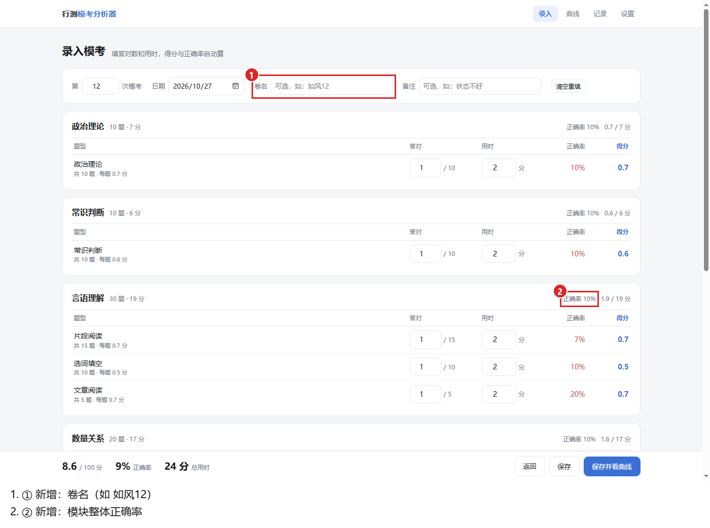
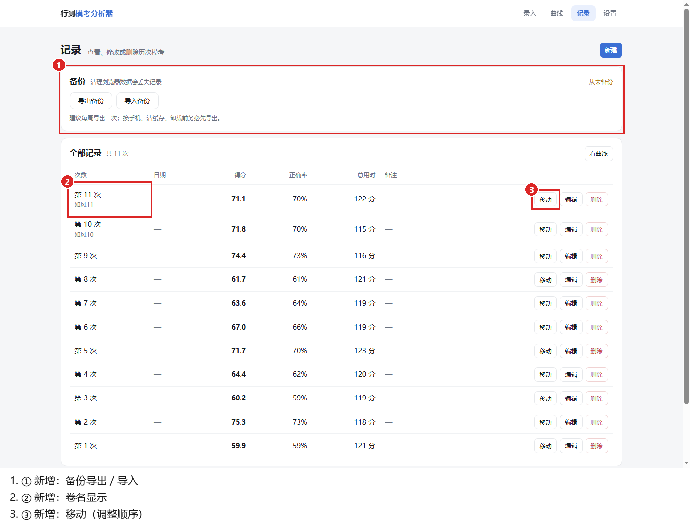
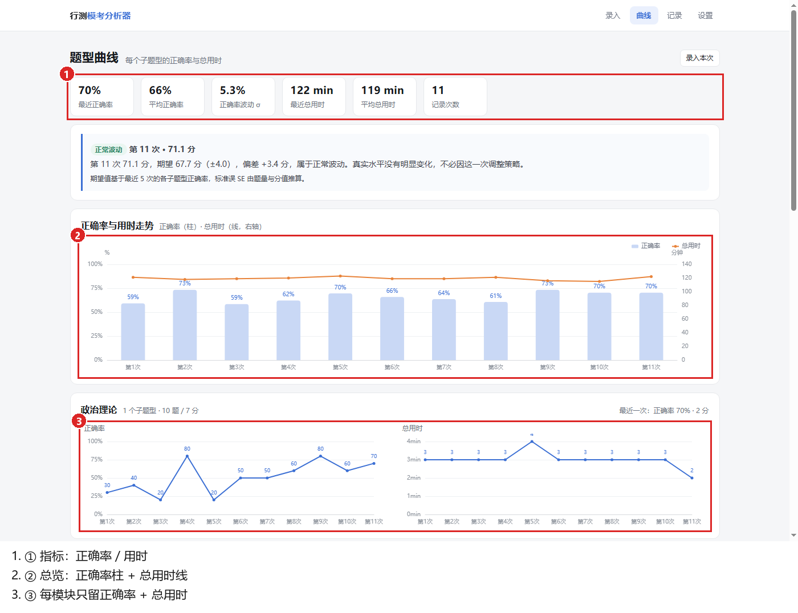
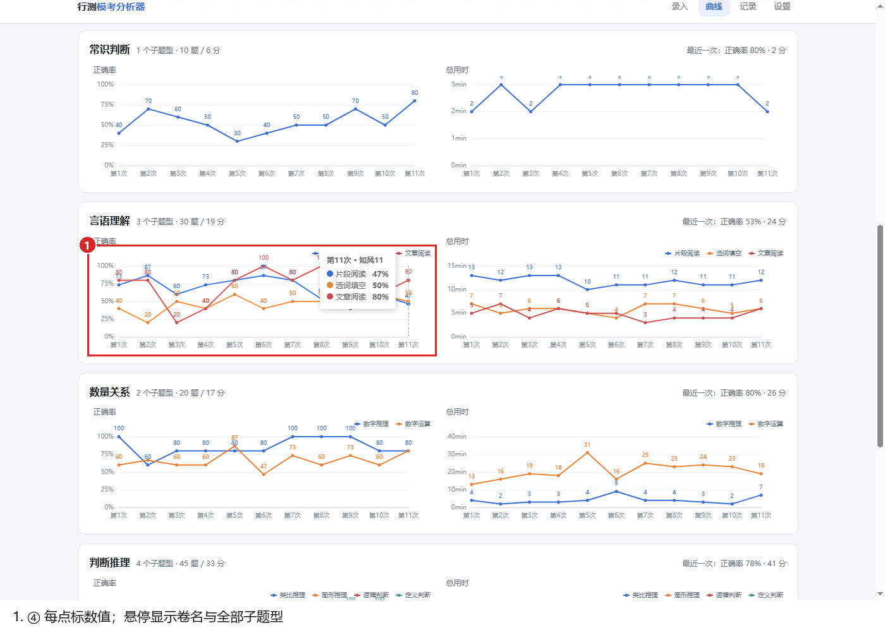

# 行测模考分析器

一个**本地运行**的行测模考记录与分析工具：录入每个题型的答对数与用时，自动算分，输出正确率与用时曲线，并判断某次成绩波动是否属于正常范围。

支持 4 套试卷结构：

| 考试类型 | 试卷类型 | 题量 | 满分 |
|---|---|---:|---:|
| 江苏 | A/B 类 | 135 | 100 |
| 江苏 | C 类 | 130 | 100 |
| 国考 | 副省级 | 130 | 100.5 |
| 国考 | 地市级 / 行政执法类 | 135 | 100 |

> 国考副省级按来源截图合计为 100.5 分（逻辑判断 10×0.85）。如认为是笔误，修改 `app/public/shared/domain.js` 中 id=31 的 `pts` 即可。

## 截图

| 录入 | 记录 |
|---|---|
|  |  |

| 曲线 | 数值提示 |
|---|---|
|  |  |

## 功能

- **按试卷录入**：选择「考试类型 + 试卷类型」，表单自动切换题型结构
- **实时计算**：子题型正确率/得分、模块正确率/总用时、整卷得分与总用时
- **曲线**：整卷正确率与用时走势；每个模块的正确率与总用时；每个数据点标注数值
- **波动诊断**：按最近 5 次同试卷历史估算期望分与标准误，判断本次是正常波动还是真实失分
- **卷名**：如「如风12」，在记录与曲线提示中显示
- **顺序调整**：把某次移动到指定位置，其余自动顺延
- **备份**：导出/导入 JSON，导入按「试卷 + 第几次」去重
- **纯本地**：无账号、无服务器、不上传数据

## 使用方式

### 电脑版（Windows）

1. 安装 Node.js 22.5+（仅从源码运行需要）
2. `npm install`
3. `npm run build:exe` 生成 `dist\行测模考分析器.exe`
4. 双击 exe，浏览器自动打开

也可以直接 `npm start` 后访问 `http://127.0.0.1:3210`。

### 安卓 APK

仓库自带 GitHub Actions 工作流，推送后自动构建：

1. 打开 Actions → `android-apk` → 最新一次运行
2. 页面底部 **Artifacts** → 下载 `xingce-analyzer-debug`
3. 解压得到 `app-debug.apk`，传到手机安装（允许未知来源）

也可以本地安装 Android Studio 后打开 `android/` 构建。

### 网页 / PWA（可选，自托管）

```bash
npm run build:www      # 生成 www/
npm run serve          # 本地预览 http://127.0.0.1:8080
```

把 `www/` 部署到任意静态托管即可；HTTPS 下支持「添加到主屏幕」与离线访问。

### 微信小程序版（独立工程）

`miniprogram/` 是单独的小程序工程，与桌面/网页版互不影响：

- 纯计算逻辑从 `app/public/shared/` 生成（`npm run build:mp`）
- UI 用小程序原生 WXML/WXSS 重写，Canvas 绘制曲线
- 数据存微信本地，导出/导入走剪贴板

详见 [miniprogram/README.md](miniprogram/README.md)（含发布前的备案、类目等准备清单）。

## 数据与隐私

- 电脑版数据在程序同目录的 `data/app.db`（SQLite）；导出会直接写到 `data/backups/`
- 网页/APK 数据在浏览器/WebView 的 IndexedDB；小程序版在微信本地存储
- **不上传任何数据**，没有后端
- 清理浏览器数据或卸载 App 会丢失记录，请定期「设置 → 导出备份」

## 项目结构

```
app/
  server.mjs            Node 入口（HTTP + 静态服务）
  lib/                  服务端分层：config/domain 之外的 db、repo、api、http、bootstrap
  public/
    shared/             浏览器与服务端共用：domain、metrics、validate、errors
    js/                 前端页面逻辑与 store 抽象（http / local）
    vendor/             ECharts 本地文件
android/                Capacitor 安卓工程
miniprogram/            微信小程序工程（独立，原生 UI）
tools/                  构建、图标、种子数据、打包脚本
tests/                  node:test 单元测试
docs/                   调研、PRD、架构、分享说明
```

## 开发

```bash
npm install
npm start          # 启动本地服务（127.0.0.1:3210）
npm test           # 单元测试（node:test）
npm run serve      # 静态预览（无 API，走本地存储）
npm run seed       # 从 Excel 重新生成 app/data/seed.json
npm run icons      # 生成 PWA 图标
npm run bump       # 生成带「年月日时分秒」的版本号
npm run build:www  # 生成 www/
npm run build:mp   # 生成小程序用的 utils/core.js
npm run build:exe  # 生成 Windows exe（Node SEA）
npm run build:release  # 生成 release/电脑版 与 release/手机版
```

版本号格式为 `主版本.次版本.修订号.年月日时分秒`，写在 `app/public/shared/version.js`，由 `npm run bump` 更新，桌面版、网页版、小程序版共用。

要求：Node.js ≥ 22.5（使用内置 `node:sqlite`），Windows 10/11 用于打包 exe。

## 技术栈

- 后端：Node.js 原生 `http` + `node:sqlite`，零运行时依赖
- 前端：原生 HTML/CSS/ES Modules + ECharts（本地文件）
- 存储：桌面端 SQLite；浏览器/App 端 IndexedDB
- 打包：Node SEA（esbuild → `--experimental-sea-config` → postject），PE 子系统改为 GUI（无控制台）
- 安卓：Capacitor 7（WebView 壳，完全离线）

## 贡献

欢迎提 Issue / PR，请先阅读 [CONTRIBUTING.md](CONTRIBUTING.md) 与 [CODE_OF_CONDUCT.md](CODE_OF_CONDUCT.md)。
安全问题请按 [SECURITY.md](SECURITY.md) 私下报告。

## 许可证

[MIT](LICENSE)

## 免责声明

本项目仅用于个人学习与备考记录，不提供题库、不售卖题目，与任何考试机构无关。
使用者需自行确保录入内容的来源合法。


