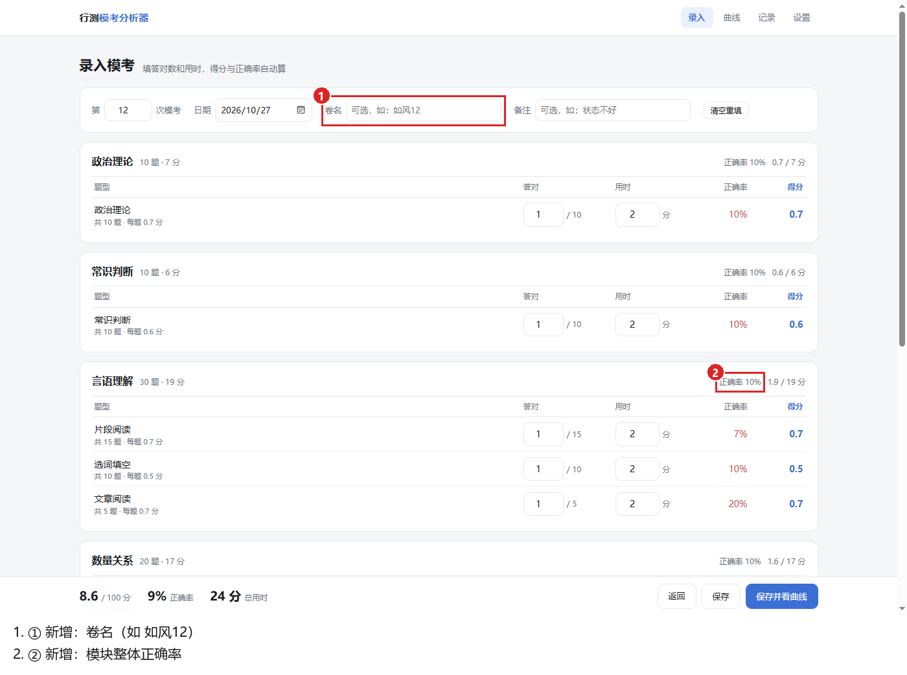
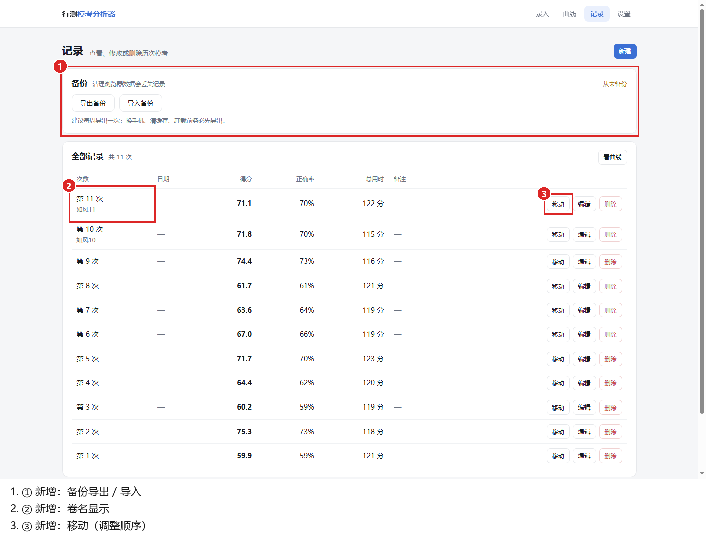
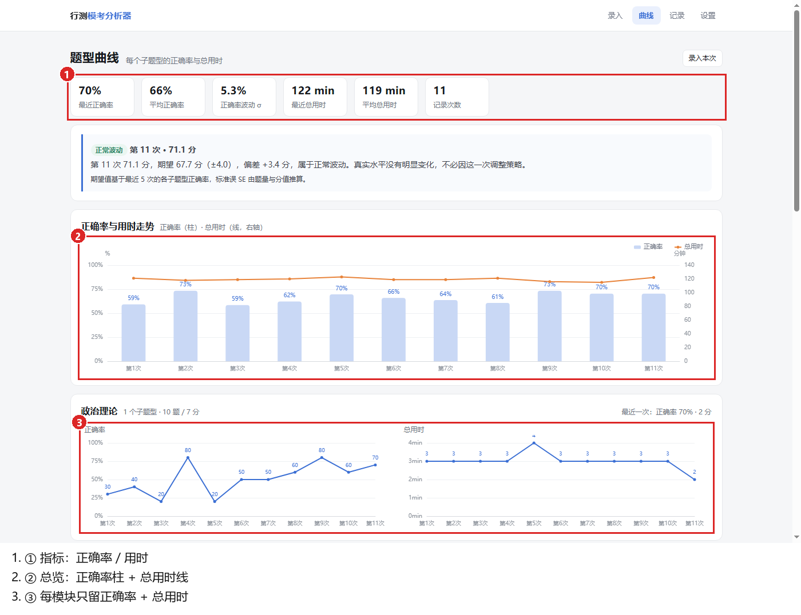
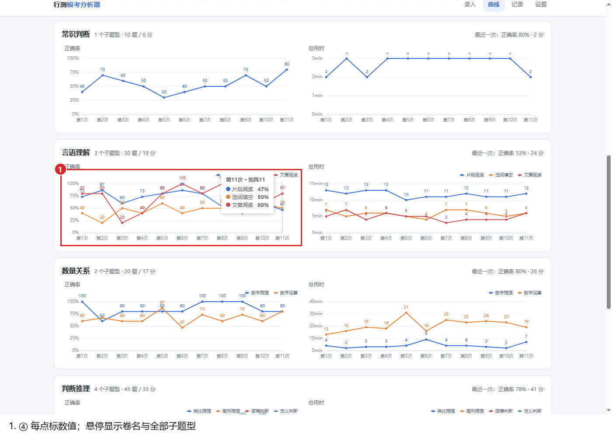

# 本次修改说明（截图版）

> 截图里的「如风10 / 如风11」是为了演示卷名临时填的，截图后已经还原，你的数据没有被改。

## 1. 录入页

1. **新增卷名**：表单里多了「卷名」，填 `如风12` 这类名称，保存后记录页和曲线都会显示。
2. **模块整体正确率**：每个模块标题右侧显示该模块的合计正确率（截图里言语理解是 3/30 = 10%），不用等保存再看。

另外：数字输入框上滚动鼠标滚轮不再改数值（滚轮会直接失焦）。这个变化截图里看不出来。

## 2. 记录页

1. **备份卡片**：导出备份 / 导入备份，右上角显示「上次备份」时间，超过 7 天标黄。
2. **卷名显示**：第 N 次下面显示卷名。
3. **移动**：点「移动」输入目标次数，把它插到那个位置，后面的记录自动顺延。

## 3. 曲线页（总览）

1. **指标改成正确率和用时**：最近/平均正确率、正确率波动、最近/平均总用时、记录次数。
2. **总览改成「正确率柱 + 总用时线」**，不再画得分。
3. **每个模块只留两张图**：正确率、总用时；删掉了「得分」「平均每题用时」。

## 4. 曲线页（每个点的数值）

1. **每个点都标数值**（重叠时自动隐藏一部分），不用悬停也能看到趋势中的具体值。
2. **悬停/点按显示提示框**：标题是「第 11 次 · 如风11」，下面是该次所有子题型的数值。

## 验证

- 单测 19/19、CRUD 25/25
- 顺序调整：`11 → 1 → 11` 顺序恢复，卷名跟随
- 手机本地存储：移动 + 卷名 + 导入导出通过
- exe：11 条记录、卷名读写、首页、退出正常
